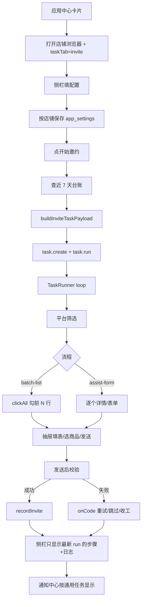
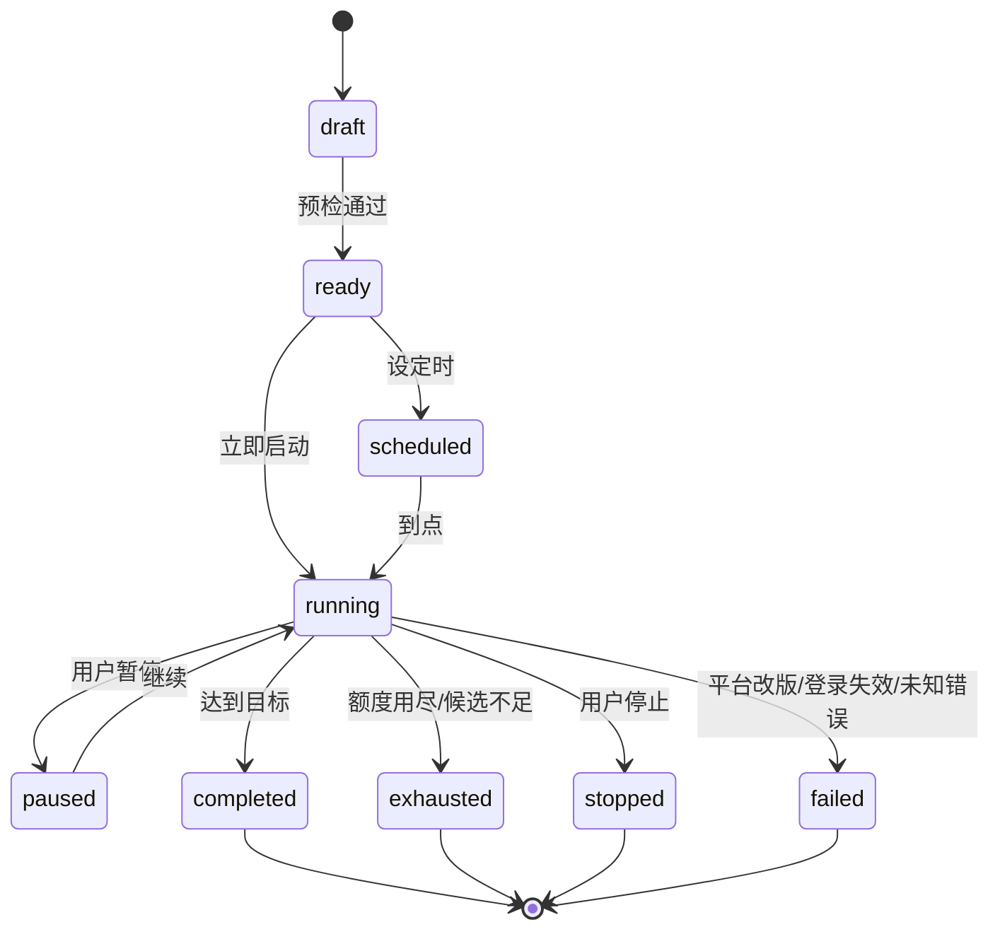
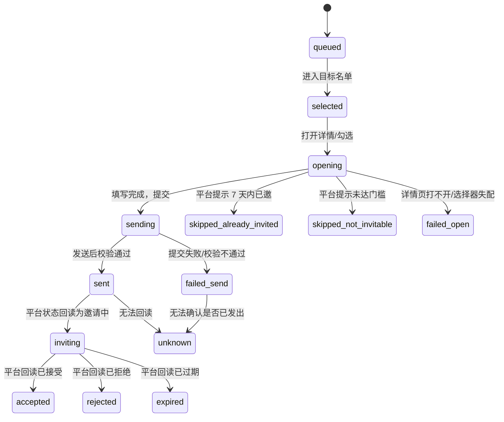
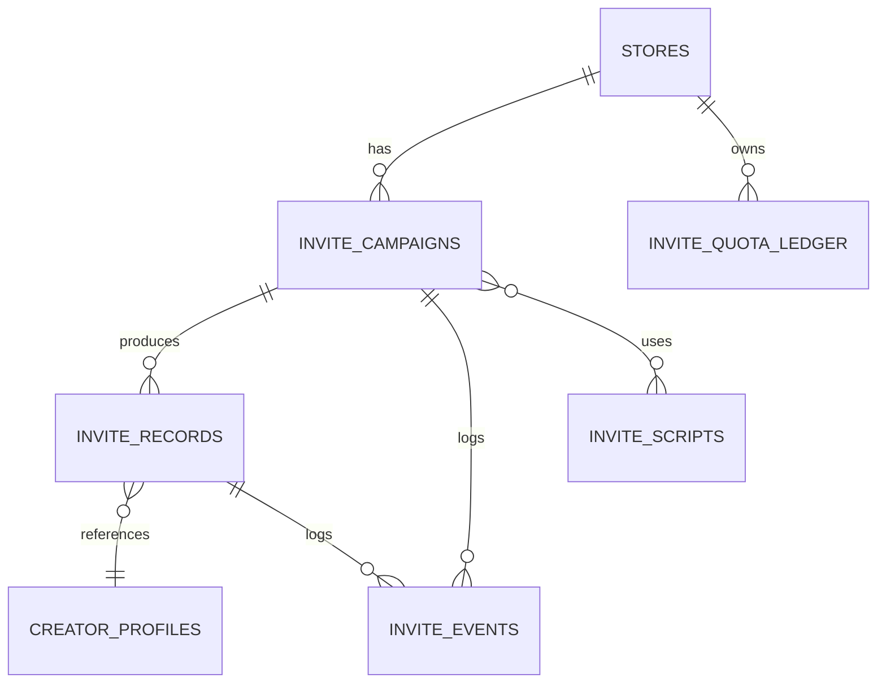

# 达人邀约模块 · 重构设计方案（应用中心 v2）

> 文档性质：功能重构方案（设计稿），不含代码实现。  
> 依据：当前工作区代码（0.4.75）、`docs/invite-optimization-report.md`、`docs/wechat-invite-steps.md`、现有单测与 CDP 验收脚本。  
> 结论先行：**执行引擎保留，业务层重建。先把「发给谁、发没发出去、结果如何」变成可查询的事实，再谈自动化和增长。**

---

## 0. 摘要

### 0.1 一句话

把现在「应用中心卡片 → 店铺浏览器右侧栏 → 一次性邀约任务」的形态，升级为「可计划、可预览、可追踪、可复盘」的独立邀约模块；平台自动化层不重写，新增策略层与结果层。

### 0.2 三个判断

1. **现有自动化是真的，别重写。** 平台档案、逐项实测的选择器、错误分类、`onCode` 自愈、幂等重试、截图留档，是这个项目最值钱的资产。重构不能把它们推倒重来。
2. **现在缺的不是更多按钮，而是业务对象。** 只有 `TaskRun`，没有「批次（Campaign）」「达人（Creator）」「邀约记录（InviteRecord）」「额度台账（QuotaLedger）」。没有这些对象，历史、状态、通知、复盘都无从谈起。
3. **最高优先级的体验断点是「发给谁不可见、发完怎么样不可知」。** 先补候选预览、逐人记录、停止原因上屏；达人库、状态回读、增长分析都排在这三件事之后。

### 0.3 十个核心决策

| # | 决策 | 理由 |
|---|---|---|
| 1 | 达人邀约升级为独立模块页；侧栏只保留「快捷发起 + 最近一次运行」 | 现在应用中心卡片把人送进店铺浏览器侧栏，配置、日志、历史全挤在窄侧栏面板里，无法承载多店铺与历史 |
| 2 | 引入 `Campaign / Run / InviteRecord` 三层对象 | `TaskRun` 只是执行载体，不能表达「这一批要邀谁、邀到了什么程度」 |
| 3 | 发送前增加「候选预览 + 目标名单」；平台读不到时如实降级为「按筛选直接邀约」 | 现在批量流是 `clickAll` 勾前 N 行，名单每次加载还会洗牌，用户无法确认发给谁 |
| 4 | 7 天去重从「昵称台账」升级为 `creator_key + 邀约记录` | 昵称会重名、会改；`finderUsername` 只有详情页才拿得到。先按「用户名优先、昵称兜底」建身份，并标注身份可信级别 |
| 5 | 新增按店铺 × 平台的「日额度台账」，把单次 `maxInvites` 升级为日上限 | 现在连点三次「开始邀约」就可能在同一天发三轮，平台额度不可见时没有任何本地护栏 |
| 6 | `stopReason`、成功/跳过/失败人数必须上屏 | 现在额度用完是「成功」，但界面只显示「已完成」，用户不知道是发完了还是被平台拦了 |
| 7 | 平台状态回读作为「可验证才启用」的能力，不猜测 | 微信文档记录「我的邀约 → 邀请中(n)」页面存在；抖店/快手状态页尚未实测。没实测就显示「平台状态未同步」 |
| 8 | 邀约事件进入通知中心，带深链和聚合规则 | 现在邀约任务只以「通用任务」出现，额度用完/部分失败/登录失效都没有专门通知 |
| 9 | 话术从「每次手填 / 每次 AI 生成」升级为「话术库 + 变量 + 合规检查 + AI 兜底」 | 现在同一批商品反复生成，超时还会拖垮整批；生成结果也没有留档 |
| 10 | 任务类型从「名称前缀 `达人邀约 ·`」改为显式 `task.kind` | 名称前缀是展示字段，用户改名、智能体建任务都会让统计和面板筛选失效 |

### 0.4 分期

| 阶段 | 范围 | 完成标志（DoD） |
|---|---|---|
| P0 基础 | 方案评审、特性开关、`task.kind`、迁移 v33、邀约记录双写、停止原因上屏 | 旧面板不改也能跑；新表有数据；统计不再依赖名称前缀 |
| P1 独立页 | 模块页骨架、工作台、批次列表/详情、按店铺配置迁移、侧栏快捷发起 | 应用中心卡片进入新页；旧侧栏仍可用；历史批次可查 |
| P2 预览/额度/通知 | 候选预览适配器、目标名单选择、日额度台账、预检清单、邀约事件通知 | 发之前能看到名单与额度消耗；发之后有结构化通知 |
| P3 状态/达人库/复盘 | 平台状态回读、达人库、黑名单、漏斗与跳过原因、CSV 导出 | 每条邀约有状态来源；能回答「为什么没接受」 |
| P4 资产/自动化 | 话术库、商品集、定时邀约、多店铺排队、审计与 PII 保护 | 可复用资产成型；多店不互相抢额度/标签页 |

### 0.5 四个核心流程的改造前后

| 流程 | 现状 | 重构后 | 关键改造 |
|---|---|---|---|
| 邀约发起 | 侧栏表单 → 直接建任务 | 工作台 → 四步向导 → 批次 → 预检 → 启动 | Campaign + 向导 + 预检清单 |
| 达人筛选 | 平台筛选 + 前 N 行（批量）/ 逐个详情（微信） | 平台筛选 + 本地排除 + 候选预览 + 目标名单 | 预览适配器 + `clickTargets/clickTarget` |
| 状态流转 | 任务状态 + 隐藏的 `stopReason` | 批次状态 + 逐人状态 + 平台回读 | 记录表 + 两套状态机 + 状态同步 |
| 通知与记录 | 通用任务通知 + 昵称台账 | 邀约事件通知 + 逐人记录 + 证据 + 复盘 | 通知扩展 + `invite_records` + 指标 |

---

## 1. 目标、场景与非目标

### 1.1 目标（按优先级）

1. **真实性**：每条记录都有来源和证据；读不到就是 `unknown`，不推断、不补零。
2. **可控性**：发之前知道「发给谁、发多少、消耗多少额度、失败了怎么办」；运行中随时能停。
3. **可追踪**：每个达人从「已发送」到「已接受/已拒绝/已过期」有状态、有时间、有来源。
4. **可复用**：筛选方案、话术、商品集、达人名单可以保存和复用。
5. **可复盘**：哪个平台、哪类筛选、哪版话术的接受率更高；样本不足时明确写「样本不足」。

### 1.2 使用场景（按发生频率排序）

| 场景 | 用户要完成的事 | 现在的问题 |
|---|---|---|
| A. 新店首邀 | 配一次联系人/话术/商品，小批量试水 | 配置藏在侧栏；试水结果只有日志，没有名单 |
| B. 日常补量 | 每天发 N 位，避开近 7 天已邀 | 没有日额度；批量流台账实际没写全（见 3.5） |
| C. 大促批量 | 多店铺、多批次、控制节奏 | 一次只能看一个店铺；没有排队与并发闸 |
| D. 复盘 | 为什么这批发出去没人接受 | 只有任务级成功/失败，没有逐人状态与漏斗 |
| E. 异常处理 | 登录过期、平台改版、限流、额度用完 | 停止原因埋在步骤 payload 里，界面不显示 |
| F. 智能体代跑 | 用同一套配置和护栏直接执行 | 智能体与面板共用构造器，但没有批次与记录可查 |

### 1.3 非目标（明确不做）

- 不逆向平台协议、不调内部 API、不模拟签名；只做真实登录态下的浏览器操作。
- 不做自动私信、自动寄样、自动签约；这些是后续独立能力，不混进邀约。
- 不做全功能 CRM；达人库只保留与邀约相关的字段。
- 不承诺平台没有暴露的指标（成交额、转化率）；没有数据就显示空态。
- 不新增「运行中逐个人工确认」的门禁。用户已明确要求「达人邀约不需要人工允许，直接执行」；本方案只增加**启动前的作战简报**和**可选的启动前确认**，不改变运行语义。

---

## 2. 现状盘点（证据化）

### 2.1 入口与信息架构

当前不是独立模块页，而是：

```
应用中心（UnifiedAppsPage.vue）
  └─ 卡片「达人邀约」entry: 'open-invite'
       └─ DashboardView.openCreatorInvite()
            ├─ 选店：正在显示 → 已打开 → 第一家
            ├─ browserTaskTab = 'invite'
            └─ 打开店铺浏览器
                 └─ 右侧栏「任务中心 → 达人邀约」子标签
```

证据：

- 卡片定义：`apps/desktop/src/renderer/src/features/workbench/UnifiedAppsPage.vue:78`；`openApp()` 对 `entry === 'open-invite'` 只发事件，`:109-115`。
- 入口处理：`DashboardView.vue:1332-1341`，注释明确写「达人邀约不是独立页面，而是店铺浏览器里的一个标签」。
- 子标签与面板：`DashboardBrowserSurface.vue:213`、`:219-336`。

影响：

- 没有独立 URL / 页面状态，离开店铺浏览器就看不到历史。
- 一次只能看一个店铺；多店铺用户无法横向对比。
- 配置、运行、日志、错误全部挤在侧栏；配置区一屏放不下，日志区只剩几行。
- 平台不支持时，卡片仍可点，进去才看到「当前平台未接入真实邀约流程」；用户会误判成功能坏了。

### 2.2 平台档案与两条流程

平台档案在 `packages/shared/src/constants/invite.ts`，每个平台一份，选择器/文案均来自真机实测，不做跨平台抽象猜配。当前接入 3 个平台、2 种流程：

| 平台 | flow | 本地单批上限 | 话术上限 | 商品上限 | 联系方式 | 额度可见性 |
|---|---|---|---|---|---|---|
| 抖店 | `batch-list` | 40（平台单次上限） | 150（改版后抽屉无 textarea，改为结构化拼装） | 5 | 手机号 + 微信号 | 页面不显示；抽屉「确认发送」禁用视为额度用尽 |
| 微信小店 | `assist-form` | 逐个，50（本地 loop 上限；默认 10） | 200 | 档案写 10，但商品 ID 校验按 30（口径冲突，见 3.5） | 联系人 + 微信号 + 手机号 | 页面文案「今日剩余」可选；平台宣称每日 200 次 |
| 快手小店 | `batch-list` | 100（档案自设；平台只标每日 100 条） | 500 | 10 | 联系人 + 手机号 + 微信号 | 抽屉底部「今日剩余 N 条发送邀请机会」 |

证据：`constants/invite.ts:406-504`（抖店）、`:534-588`（微信）、`:613-769`（快手）、`:772-785`（注册表与 `inviteProfileFor`）。

两条流程的差异：

- `batch-list`：广场筛选 → 批量勾选 N 行 → 批量邀约抽屉 → 填必填项/选商品 → 确认发送 → 校验抽屉关闭。
- `assist-form`：广场筛选 → 逐个点「详情」→ 详情页「邀请带货」→ 表单页 → 填联系人/话术/商品 → 发送 → 等平台确认框 → 校验表单清空。

关键事实：**两条流程都没有运行中的人工确认门禁**。`invite-steps.ts:11-13`、`:164-165`、`:505-507` 明确写了「用户要求直接执行」，发送前保护是额度/可用性预检、平台必填项校验、发送后结果校验三道程序化判据。`docs/invite-optimization-report.md` 里「批量流：人工确认门禁」的描述与代码不一致，属于过期文档（见附录 C）。

### 2.3 邀约发起

现状链路：

```
面板表单（按店铺存 app_settings）
  → normalizeInviteTaskConfig() 收口
  → inviteTaskIssues() 逐条校验
  → buildInviteTaskPayload() 生成 name + steps
  → window.shopilot.task.create()
  → window.shopilot.task.run()
```

证据：

- 配置键：`packages/shared/src/invite-config.ts:12-23`，按店铺 `invite.config.store.<storeId>`；旧版按平台 `invite.config.<platform>` 仅作为首次迁移初始值。
- 表单状态与默认值：`DashboardBrowserSurface.vue:1128-1139`。
- 加载/迁移/自动保存：`:1582-1621`、`:1644-1652`；手动保存 `:1634-1642`。
- 校验：`packages/shared/src/invite-task.ts:139-202`。
- 构造：`invite-task.ts:205-282`。
- 启动：`DashboardBrowserSurface.vue:1727-1763`。
- 智能体同一构造器：`apps/desktop/src/main/services/agent-service.ts:2261-2283`，`runInvite` 读已保存配置、可覆盖 `count`，校验后委托任务。

现有校验能拦下的事（逐条可读）：

- 话术为空（手填模式；AI 模式视为就绪，运行时未配置 AI 会报 `AI_NOT_CONFIGURED`）。
- 微信流缺联系人/微信号/手机号。
- 筛选值不在平台实测清单（平台改名后的旧值，如「汽车电动」→「汽摩电动」）。
- 「带货销售总额」用在非「全部带货者」类型下。
- 「本次最多邀约」越界（1–50）。
- 批量流缺达人等级、数量越界、权益/核心优势超上限、联系方式缺失。

### 2.4 达人筛选

批量流（抖店/快手）：

- 类目（抖店三级、快手二级）、达人等级（仅抖店有）、权益/合作标签、核心优势、额外筛选行（快手四行）。
- 勾选阶段按「近 7 天已邀昵称」`skipTexts` 跳过。
- 数量由「每批邀约数量」控制；快手最少 2 位（只勾 1 位平台静默无反应）。

辅助流（微信）：

- 带货者类型 4 种、带货类目 34 项、带货销售总额 16 档、其他筛选 7 项；选项全部来自实测清单。
- 「打开达人广场」会真的应用筛选并回读勾选态，返回可见「详情」条数；列表 0 条时会提示先别开始。
- 开跑前查台账，点「详情」前跳过近 7 天已邀昵称；平台侧「7 天内不可再次邀请」兜底。

证据：`DashboardBrowserSurface.vue:226-312`、`:1659-1725`；`invite-steps.ts` 的筛选步骤；`docs/wechat-invite-steps.md`。

关键缺口：

- **批量流没有候选预览**。`clickAll` 直接勾「前 N 个可用行」，引擎只回传 `samples` 前 8 个名字用于诊断（`task-runner.ts:3295`、`:3328`），界面不展示完整名单。
- **列表每次加载会洗牌**。`docs/wechat-invite-steps.md` 明确写「列表每次加载都洗牌」；预览与实发之间名单可能变化。
- **「打开达人广场」在批量流只是导航**（抖店额外读三级类目），不应用筛选、不返回名单；与微信流的能力不一致。

### 2.5 执行与状态

执行引擎：`apps/desktop/src/main/tasks/task-runner.ts`。

- 外层 1 个 `loop`，每轮 = 邀约 1 位（微信）或 1 批（抖店/快手）。
- `stopOn`：`TASK_QUOTA_EXCEEDED`、`TASK_SELECTION_SHORTFALL`（批量流还含 `TASK_DRAWER_NOT_OPEN`）命中即干净收工，不算失败。
- `onCode`：
  - `TASK_PAGE_EXHAUSTED`：翻页（上限 10 次）。
  - `TASK_DAREN_PAGE_UNOPENABLE`：退避 20s 重开本轮（上限 6 次），保留已访问记录。
  - `TASK_DAREN_NOT_INVITABLE`：换下一位（上限 20 次）。
  - `TASK_DAREN_ALREADY_INVITED`：换下一位（上限 20 次）。
- 每轮成功写 `invite_history`；写失败只记 error，不影响本轮结果（`task-runner.ts:2996-3013`）。

任务/运行状态：

- `tasks.status`、`task_runs.status`：`queued / running / paused / waiting_confirmation / succeeded / failed / cancelled`。
- `loop` 步骤 payload 里有 `completedRounds / stopReason / rounds[]`（`task-runner.ts:3032-3040`）。
- **但 `stopReason` 没有在邀约面板展示**；面板只显示 `inviteStatus()` 的通用文案（`DashboardBrowserSurface.vue:1794-1797`），以及「卡在第 N/M 步」和日志。

结论：现在的「状态流转」主要是**任务执行状态**，不是**邀约业务状态**。用户无法知道「这一批到底发出去几位、跳过几位、为什么停」。

### 2.6 通知

- 通知中心是渲染层纯函数：`notification-center.ts:57-120`，只聚合「进行中/待确认/24h 内失败的任务 + 客服未读」，上限 8 条、失败最多 3 条。
- 邀约任务以通用任务身份出现，标题是「任务「达人邀约 · …」运行失败/正在运行」，没有「额度用完」「已发 N 位」「登录失效」「新增 N 位接受」等邀约语义。
- 没有已读/未读持久化、没有桌面通知、没有通知偏好、没有深链到具体批次/达人。

### 2.7 记录

- 表 `invite_history`：`id / store_id / platform / nickname / finder_username / task_id / run_id / invited_at`（`migrations.ts:1575-1603`）。
- 服务：`invite-history.ts:30-88`，提供 `recordInvite`、`recentInvitedNicknames`、`listInvites`。
- IPC：`invite-handlers.ts:24-39`，返回 `nicknames + entries`。
- 前端只用 `recentInviteHistory()` 拿昵称数量，**没有列表界面**（`DashboardBrowserSurface.vue:1737-1743`）。
- 没有状态、没有话术快照、没有商品快照、没有失败原因、没有操作者、没有幂等键。
- 截图存在 `task_step_results.artifact_path`，但没有画廊/证据包入口。

### 2.8 智能体、验收与测试

- 智能体 `runInvite` 与面板共用 `normalizeInviteTaskConfig / inviteTaskIssues / buildInviteTaskPayload`，这是正确的单一事实来源。
- 单测：`tests/unit/invite.test.ts`（1331 行）、`invite-config.test.ts`、`invite-block-notice.test.ts`、`agent-invite-task.test.ts`、`step-retry-idempotency.test.ts` 等。
- CDP 验收：`tools/acceptance/m1-cdp-verify.js:1175-1297`、`m3-cdp-verify.js:964-1087`、`dashboard-apps-cdp-verify.js:170-189`；依赖 `data-test="invite-panel"`、`invite-start`、`invite-max-invites`、`invite-live-log` 等锚点。
- 概览服务已经算了邀约状态分布与最近 10 条（`overview-service.ts:552-579`），但前端没有消费这份数据。

### 2.9 可复用资产（不要重做）

| 资产 | 位置 | 价值 | 处理 |
|---|---|---|---|
| 平台档案 | `packages/shared/src/constants/invite.ts` | 3 平台真机实测的选择器/文案/上限 | 保留，补能力字段 |
| 任务构造器 | `packages/shared/src/invite-task.ts` | 面板与智能体单一事实来源 | 保留，扩展批次快照 |
| 预检校验 | `inviteTaskIssues()` | 逐条可读、运行前拦截 | 保留，扩展预检项 |
| 错误分类与恢复 | `task-runner.ts` + `error-classifier.ts` | 额度/候选/门槛/已邀/详情打不开分流 | 保留，不改语义 |
| 7 天台账 | `invite-history.ts` | 去重基础 | 升级为记录表，保留旧表兼容 |
| 截图与步骤结果 | `task_step_results` | 真实证据 | 保留，增加查询/画廊 |
| 验收锚点 | `tools/acceptance/*` | 防止 UI 回归 | 过渡期双锚点 |
| 单测 | `tests/unit/invite*.test.ts` | 平台档案/构造/拦截 | 全量保留 |

---

## 3. 现有核心流程与断点

### 3.1 端到端流程（现状）



### 3.2 批量流一轮做什么

```
导航广场 → 等筛选区渲染 → 应用类目/等级/权益/额外筛选
→ clickAll 勾 N 行（虚拟滚动，最多 25 轮）
→ 点「批量邀约」开抽屉
→ 额度/可用性预检（抖店看「确认发送」是否禁用）
→ 填联系方式/选商品/填话术（快手）
→ 发送 → 等抽屉关闭 / 商品行清空 → 截图
```

### 3.3 辅助流一轮做什么

```
导航广场 → 应用四类筛选 → 等「详情」
→ 点一个未访问的详情（跳过台账昵称）→ 详情页
→ 点「邀请带货」→ 表单页
→ 额度预检（可选）→ 填联系人/微信/手机号
→ AI 或手填话术 → 按商品 ID 添加商品
→ 发送 → 等平台确认框 → 确认
→ 等弹窗关闭 + 商品行清空 → 截图
```

### 3.4 状态与异常（现状）

现状只有任务级状态，没有邀约记录级状态：

```
queued → running → succeeded
                 → failed
                 → cancelled
        ↘ paused → running
        ↘ waiting_confirmation（任务框架保留，但邀约流程不使用：无人工门禁）
```

`invite_history` 只记「发过」，不记「发到哪一步、平台怎么说」。因此「状态流转」实际上只存在于 `task_runs.status` 和 `loop` 步骤的 `stopReason` 里，且后者不在界面展示。

| 触发 | 现在的处理 | 是否算失败 | 用户能看到什么 |
|---|---|---|---|
| 额度用完 | `stopOn TASK_QUOTA_EXCEEDED`，干净收工 | 否 | 「已完成」，看不到「额度用完」 |
| 候选不足 | `stopOn TASK_SELECTION_SHORTFALL`，干净收工 | 否 | 「已完成」，看不到「只发了几位」 |
| 本页都点过 | 翻页，上限 10 次 | 否 | 日志里有，面板不突出 |
| 详情页打不开 | 退避 20s 重开本轮，上限 6 次 | 撞满才失败 | 「卡在第 N 步」，原因在日志 |
| 未达合作门槛 | 换下一位，上限 20 次 | 连续撞满按预期收尾 | 日志里有，面板不汇总 |
| 7 天内已邀 | 换下一位，上限 20 次 | 否 | 日志里有，面板不汇总 |
| 平台改版/选择器失配 | `TASK_SELECTOR_CHANGED` | 是 | 任务失败，原因在日志 |
| 登录态失效 | `TASK_TIMEOUT` 或 `matchSessionStall` 提示 | 是 | 任务失败，原因在日志 |

### 3.5 十三个断点（证据 → 影响 → 对策）

| # | 断点 | 证据 | 影响 | 对策 |
|---|---|---|---|---|
| 1 | 不是独立模块，入口是侧栏标签 | `DashboardView.vue:1332-1341`、`DashboardBrowserSurface.vue:219` | 无历史、无多店对比、配置与日志挤在一起 | 独立模块页 + 侧栏快捷发起 |
| 2 | 批量流没有候选预览 | `task-runner.ts:3060-3328`；只回传 `samples` 前 8 个 | 用户不知道发给谁；名单洗牌后无法复核 | 候选预览适配器 + 目标名单 |
| 3 | **批量流实际上没有写全邀约台账** | `recordInvite` 只在 `run.pendingCreatorNickname` 存在时调用（`task-runner.ts:3001`）；该字段只由辅助流 `clickByText` 的 `recordRowText` 赋值（`:2547-2548`）；`clickAll` 不回传完整名单 | 抖店/快手的「近 7 天已邀」台账基本为空；面板的「会自动跳过 N 位」对批量流是误导；重复邀约只能靠平台兜底 | `clickAll` 回传完整 `clickedNames`；批次发送成功后逐人写记录 |
| 4 | 7 天去重身份只有昵称 | `invite-history.ts:4-9` 注释明确「列表行拿不到 finderUsername」 | 重名会误跳过/误放行；改名后失效 | `creator_key`：用户名优先、昵称兜底，标注身份可信级别 |
| 5 | 额度只有单次 `maxInvites` | `DashboardBrowserSurface.vue:316-319`；`invite-task.ts:181-184` | 同一天多次运行可叠加超额；平台额度不可见时无护栏 | 日额度台账 + 预留/已用/剩余 |
| 6 | 停止原因不上屏 | `task-runner.ts:3032-3040` 写入 payload；面板 `:1794-1815` 只显示通用状态 | 用户分不清「发完了」「额度用完」「被平台拦了」 | 批次摘要卡：成功/跳过/失败/停止原因 |
| 7 | 平台邀约状态没有回读 | `invite_history` 无状态列；`invite-handlers.ts` 只返回昵称/条目 | 无法知道谁接受了、谁拒绝了；没有漏斗 | 状态回读适配器；未实测平台显示「未同步」 |
| 8 | 通知是通用任务语义 | `notification-center.ts:57-120` | 额度用完/部分失败/登录失效没有专门提醒 | 邀约事件通知 + 深链 + 聚合 |
| 9 | 台账有 IPC 没有界面 | `invite-handlers.ts:24-39`；渲染层只用 `recentInviteHistory` 取数量 | 记录不可查、不可导出、不可核对 | 邀约任务详情 + 记录表 + CSV |
| 10 | 话术没有资产化 | 面板每次手填；AI 每个达人生成一次（`invite-steps.ts` 的 `aiGenerate`） | 重复生成、超时拖垮整批、无法比较效果 | 话术库 + 变量 + 合规检查 + AI 兜底 |
| 11 | 架构判定依赖任务名前缀 | `DashboardBrowserSurface.vue:1217`、`overview-service.ts:553` | 改名/智能体建任务后统计失效 | `tasks.kind = 'creator_invite'` |
| 12 | 单体组件过重 | `DashboardBrowserSurface.vue` 2156 行，邀约相关匹配 237 处 | 改一处容易碰坏别的功能；难测试 | 拆 composables/components；旧面板降级为快捷入口 |
| 13 | 口径不一致 | 微信档案 `maxProducts: 10`（`constants/invite.ts:563`）vs 商品 ID 校验 30（`invite-task.ts:149`）vs 注释「上限 30」；`parseInviteProductIds` 已先截 30，导致 `>30` 校验永远不触发 | 用户不知道到底能填几个；校验形同虚设 | 档案增加 `assistMaxProducts`，校验改为「原始输入 > 上限」并逐条报错 |

补充两个文档/文案问题：

- `docs/invite-optimization-report.md` 说批量流有人工确认门禁，代码明确没有；以代码为准。
- 应用中心卡片写「批量发起邀约」，但微信小店是逐个邀约；文案应改为「按平台流程发起邀约」。

---

## 4. 重构方案

### 4.1 设计原则

1. **执行层不动，业务层重建。** `task-runner`、平台档案、错误分类、恢复策略保持原语义；新增的是批次、记录、额度、状态、通知。
2. **一切状态有来源。** `status_source` 必填：`local` / `platform` / `manual`。平台没读到就是 `unknown`，不根据「没出现」推断「已过期」。
3. **能力由档案声明，界面不猜。** 平台是否支持预览、选目标、读额度、读状态，全部写在能力矩阵里；不支持的平台显示原因，不显示假按钮。
4. **先预览后发送，先预检后扣额度。** 预览是只读的；预检不通过不创建运行；额度先预留、发送成功后提交、失败释放、未知保留待核对。
5. **兼容迁移，双写一版。** 旧侧栏、旧表、旧 IPC 在一个版本内继续可用；新页面用特性开关切换；验收锚点双份。

### 4.2 三层模型

```
┌─────────────────────────────────────────────────────────────┐
│ 策略层（新增）                                                │
│ Campaign（批次）· Creator（达人库）· Script/Product（资产）    │
│ Quota（日额度）· Filters（筛选方案）                           │
└──────────────────────────┬──────────────────────────────────┘
                           │ 预检通过 → 生成 TaskRun
┌──────────────────────────▼──────────────────────────────────┐
│ 执行层（保留）                                                │
│ TaskRunner · 平台档案 · loop/onCode · 截图 · 幂等重试          │
└──────────────────────────┬──────────────────────────────────┘
                           │ 每轮结果 → 逐人写记录
┌──────────────────────────▼──────────────────────────────────┐
│ 结果层（新增）                                                │
│ InviteRecord（逐人状态）· StatusSync（平台回读）               │
│ Notification（事件）· Analytics（漏斗/跳过原因）               │
└─────────────────────────────────────────────────────────────┘
```

一句话：**Campaign 决定「邀谁、邀多少、用什么话术」；TaskRun 只负责「把它真实执行掉」；InviteRecord 负责「留下事实」。**

### 4.3 信息架构

应用中心 → 达人邀约（独立页，`activePage = 'creator-invite'`）：

```
达人邀约
├─ 工作台
│   ├─ 今日概览：已发 / 进行中 / 待跟进 / 今日额度
│   ├─ 最近批次（5 条）
│   └─ 快捷操作：新建邀约 / 打开达人广场 / 同步平台状态
├─ 邀约任务
│   ├─ 批次列表（按店铺、平台、状态、时间筛选）
│   └─ 批次详情（进度、漏斗、逐人记录、时间线、日志、截图、重试）
├─ 达人库
│   ├─ 达人列表（平台、类目、等级、最近邀约、状态、标签、黑名单）
│   └─ 达人详情（邀约时间线、话术、商品、证据、备注）
├─ 资产
│   ├─ 话术库（平台、长度、模式、变量、使用次数）
│   └─ 商品集（店铺、平台、商品 ID 列表）
└─ 设置
    ├─ 店铺邀约配置（联系人/微信/手机号/默认商品/默认话术）
    ├─ 发送策略（日上限、发送前确认、节奏、状态同步频率）
    ├─ 通知偏好（事件类型、静默时段、聚合方式）
    └─ 数据与证据（保留期、导出、清理）
```

「新建邀约」不是 Tab，是右上角主按钮，打开四步向导。侧栏保留一个「快捷发起」卡片：显示当前店铺、平台、今日额度、最近一次运行，点「新建邀约」跳到同一向导；点「查看全部」跳到模块页。**不再在侧栏维护第二套完整表单。**

### 4.4 页面规格

#### 工作台

| 区块 | 内容 | 数据来源 | 空态 |
|---|---|---|---|
| 今日概览 | 已发送、进行中、待跟进（已接受/已拒绝）、今日额度剩余 | `invite_records` + `invite_quota_ledger` | 显示「今天还没有邀约」+ 新建按钮 |
| 最近批次 | 名称、平台、状态、已发/目标、停止原因、时间 | `invite_campaigns` + 最近 run | 显示「还没有批次」 |
| 平台提醒 | 登录态、平台改版、额度不足、未同步状态 | 预检/同步结果 | 无提醒时不占位 |
| 快捷操作 | 新建邀约、打开达人广场、同步状态、导出记录 | — | — |

#### 邀约任务列表

列：批次名称、店铺/平台、状态、目标/已发/跳过/失败、创建人、开始时间、耗时、操作（查看/停止/克隆/导出）。

筛选：店铺、平台、状态、时间范围、创建人（人工/智能体）、是否有失败。

状态 chip：草稿、待执行、定时中、执行中、已暂停、已完成、额度用尽、候选不足、已停止、失败。

#### 批次详情

- 头部：名称、店铺/平台、状态、进度条、操作（暂停/停止/克隆/导出）。
- 摘要卡：目标 N、已发 N、跳过 N、失败 N、额度消耗 N、停止原因、耗时。
- 漏斗：已发送 → 邀请中 → 已接受 → 已拒绝/已过期（仅状态同步启用时显示后三档；否则显示「平台状态未同步」）。
- 逐人记录表：达人、身份可信级别、状态、状态来源、时间、话术、商品、证据链接、失败原因。
- 时间线：批次创建 → 预检 → 启动 → 每轮结果 → 停止/完成。
- 日志与截图：按轮次分组；截图可放大；失败步骤高亮。
- 操作：重试失败项（遵守 7 天窗口）、补发未找到的目标、复制为新批次。

#### 达人库

列：达人昵称、平台、身份（用户名/仅昵称）、类目、等级、近 30 日销售额（有则显示，无则「—」）、最近邀约、累计邀约、最近状态、标签、黑名单。

操作：查看详情、加标签、加备注、加入黑名单（填原因）、导出。

达人详情：基本信息、邀约时间线（每次批次/话术/商品/状态/证据）、备注、黑名单开关。

#### 资产

- 话术库：名称、平台、模式（手填/AI）、模板、变量、长度、最近使用、使用次数、状态。
- 商品集：名称、店铺、平台、商品 ID 列表、最近使用。

#### 设置

- 店铺配置：联系人/微信/手机号、默认商品集、默认话术、默认筛选方案；沿用按店铺存储，旧键迁移。
- 发送策略：日上限（默认取平台单批上限，可调低；调高需二次确认）、发送前确认（默认关）、批次间冷却（默认关/可配）、状态同步频率。
- 通知偏好：运行完成、额度用尽、失败、登录失效、状态变化（每日聚合）、额度不足；静默时段。
- 数据与证据：记录保留期（默认 180 天）、截图保留期（默认 90 天）、导出、清理。

### 4.5 发起流程（四步向导）

#### 步骤 1：店铺与目标

- 店铺选择器：默认当前店铺；显示平台、登录态、平台是否支持。
- 平台能力卡：流程类型（批量/逐个）、单批上限、话术上限、商品上限、额度可见性、是否支持候选预览/状态回读。
- 批次名称：默认 `平台 · 店铺 · 类目 · 日期`，可改。
- 目标数量：默认平台单批上限的 1/4（小步试水），可改；不能超过日额度剩余。

#### 步骤 2：筛选与排除

- 平台原生筛选：直接复用档案（类目/等级/销售额/其他），不另造一套。
- 本地排除规则：
  - 排除近 N 天已邀（默认 7，可改 1–90）。
  - 排除黑名单。
  - 排除已接受/已合作（状态同步启用时）。
  - 排除同名风险（身份仅昵称且昵称重复）。
- 目标数量与候选数量：点「预览候选」后显示「可读候选 N 位 / 目标 M 位」；不足时提示。
- 「保存为筛选方案」：存名称 + 平台 + 筛选快照，供下次复用。

#### 步骤 3：候选与内容

- 候选表：勾选、达人昵称、身份、等级、类目、销售额、最近邀约、状态、排除原因。
- 批量操作：全选可读项、清空、仅选未邀过、按类目/等级筛选。
- 预览降级：平台不支持/读取失败时，显示明确横幅「该平台暂不支持候选预览，将按当前筛选直接邀约 N 位」，并要求勾选「我已知晓名单不可预览」。
- 话术：
  - 选择话术库模板，或手填，或 AI 生成。
  - 变量：`{{nickname}}`、`{{store}}`、`{{category}}`、`{{product}}`、`{{benefit}}`。
  - 预览：按第一位候选渲染；显示字数/平台上限；超限阻止。
  - 合规检查：空话术、超长、平台禁用词（可配置）、未替换变量、纯链接。
  - AI 失败兜底：使用模板/手填话术，不中断整批；记录 `ai_fallback` 事件。
- 商品：选择商品集或手填 ID；显示平台上限；校验格式与去重。
- 发送策略：立即/定时；发送前确认（默认关）；批次间冷却。

#### 步骤 4：预检与启动

预检清单（阻断项 / 警告项）：

| 检查 | 级别 | 来源 | 说明 |
|---|---|---|---|
| 平台已接入 | 阻断 | `inviteProfileFor` | 未接入不显示向导 |
| 店铺已打开/登录态 | 阻断 | 会话检查/打开广场探测 | 登录失效先去登录 |
| 配置完整 | 阻断 | `inviteTaskIssues` | 逐条列出 |
| 目标数量 ≥ 1 且 ≤ 日额度剩余 | 阻断 | 配额台账 | 超出需改数量或调上限 |
| 候选数量 ≥ 目标 | 警告 | 预览 | 不足时按实际可读数量启动或返回筛选 |
| 话术非空/不超长/变量已替换 | 阻断 | 话术校验 | AI 模式视为运行时生成，但要有兜底模板 |
| 商品数量/格式 | 阻断 | 商品校验 | 平台上限 |
| 联系方式完整 | 阻断 | 店铺配置 | 按平台要求 |
| 7 天内重复 | 警告 | 记录表 | 自动跳过，显示人数 |
| 同名风险 | 警告 | 达人库 | 仅昵称身份且重名 |
| 并发锁 | 阻断 | 运行锁 | 同店铺同平台同时只允许一个运行 |
| 平台改版风险 | 警告 | 最近一次失败 | 提示先小批量试跑 |

启动按钮文案：**「开始邀约（真实发送）」**。旁边固定说明：「点击后按平台流程真实发送，不可撤回；已发出的邀约只能在平台侧查看。」

如果开启「发送前确认」，点击后弹一次最终确认框（不是逐人门禁），确认后才 `task.run()`；默认关闭，保持现有「直接执行」语义。

### 4.6 筛选与候选

#### 预览适配器

新增只读能力：`readCandidates(storeId, profile, filters, limit)`。

返回：

```ts
interface CandidateRow {
  creatorKey: string            // 用户名优先，昵称兜底
  identityLevel: 'username' | 'nickname'
  nickname: string
  level?: string
  categories?: string[]
  salesTier?: string
  recentInvitedAt?: number
  status?: string
  rawText: string               // 原始行文本，便于核对
  rowIndex: number
}
```

约束：

- 只读，不点击、不勾选、不改变平台状态。
- 读不到就返回 `{ supported: false, reason }`；不返回空数组冒充「没有候选」。
- 不猜字段：平台没显示的等级/销售额就是 `undefined`，界面显示「—」。
- 预览时间戳必须显示；列表洗牌是已知事实，预览是「参考名单」，执行时以目标名单重新匹配。

#### 目标名单执行

- 批量流：新增 `clickTargets` 步骤（或在 `clickAll` 上增加 `targets` 参数），按昵称/行文本滚动查找并勾选指定目标；找不到的目标记录 `not_found`，继续下一个；**绝不拿别的行顶替**。
- 辅助流：新增 `clickTarget`（按昵称点「详情」），找不到就翻页/报候选不足。
- 没预览的批次：保留 `clickAll` 原逻辑，按前 N 行勾选；记录实际勾到的完整名单（`clickedNames`），不再只留 8 个样本。
- 发送后：以实际勾选名单写记录，不以预览名单写记录。

#### 去重与身份

`creator_key` 生成规则：

- `finderUsername` 存在：`u:<username>`，`identity_level = 'username'`。
- 否则：`n:<normalize(nickname)>`，`identity_level = 'nickname'`。`normalize` 只做 `trim + 小写 + 去空白`，不做拼音/模糊匹配。
- 同名风险：同一 `store_id + platform` 下出现多个不同 `creator_key` 但同昵称，界面提示「同名风险，可能误跳过」。
- 7 天窗口按 `invited_at >= now - days` 计算；同一 `creator_key` 在窗口内存在 `sent/accepted/inviting` 记录则跳过。
- 平台侧「7 天内不可再次邀请」仍是最终权威；本地跳过只是省一次详情页访问。

### 4.7 执行与状态流转

#### 批次状态机



状态与 `TaskRun` 的映射：

| Campaign | TaskRun | 判定 |
|---|---|---|
| draft | 无 | 配置未完成/未预检 |
| ready | 无 | 预检通过，未启动 |
| scheduled | queued | 定时等待 |
| running | queued/running | 执行中 |
| paused | paused | 用户暂停 |
| completed | succeeded + `stopReason=target_reached` | 达到目标 |
| exhausted | succeeded + `TASK_QUOTA_EXCEEDED` / `TASK_SELECTION_SHORTFALL` | 干净收工，不是失败 |
| stopped | cancelled | 用户取消 |
| failed | failed | 平台改版/登录失效/未知 |

#### 逐人记录状态机



显示状态（表格用）：

| 显示 | 内部状态 | 说明 |
|---|---|---|
| 待发送 | queued/selected | 还没提交 |
| 发送中 | opening/sending | 正在操作 |
| 已发送 | sent | 本地校验通过，平台可能还在邀请中 |
| 邀请中 | inviting | 平台回读 |
| 已接受 | accepted | 平台回读 |
| 已拒绝 | rejected | 平台回读 |
| 已过期 | expired | 平台回读 |
| 已跳过（7 天内已邀） | skipped_already_invited | 平台/本地判定 |
| 已跳过（未达门槛） | skipped_not_invitable | 平台判定 |
| 打开失败 | failed_open | 详情页/选择器 |
| 发送失败 | failed_send | 提交失败 |
| 状态未知 | unknown | 无法确认，需核对 |

#### 记录写入规则（关键）

1. **批量勾选成功 ≠ 发送成功。** 只有发送后的校验通过（抽屉关闭/表单清空/平台提示成功）才写 `sent`。
2. **批量发送失败但已点过发送**：这一批的 N 位全部写 `unknown`，原因 `send_unconfirmed`，并在详情页提示「平台未确认，请到我的邀约核对」。不能写 `sent`，也不能写 `failed_send` 断言没发出去。
3. **辅助流**：一轮一位，发送后两条校验通过写 `sent`；失败写 `failed_send` 或 `unknown`（取决于是否已点确认）。
4. **幂等**：唯一键 `(run_id, round, creator_key)`；重试/重跑不重复写。
5. **话术快照**：记录实际发送的话术（AI 生成的也存），不只存模板 ID。
6. **商品快照**：记录实际添加的商品 ID。
7. **证据**：记录 `task_step_results` 的截图路径；没有截图就留空，不假装有。

#### 停止原因上屏

批次摘要卡固定显示：

- `target_reached`：已达到目标 N 位。
- `quota_exhausted` / `TASK_QUOTA_EXCEEDED`：平台额度用尽，已发 N 位。
- `no_candidates` / `TASK_SELECTION_SHORTFALL`：当前筛选下没有更多可邀达人，已发 N 位。
- `user_stopped`：用户停止，已发 N 位。
- `auth_required`：登录失效，已发 N 位。
- `platform_changed`：平台改版/选择器失配，已发 N 位。
- `rate_limited`：平台限流，已发 N 位。
- `circuit_open`：连续失败触发熔断，已发 N 位。
- `failed`：未知错误，已发 N 位。

### 4.8 通知

通知事件表：

| 事件 | 触发 | 语气 | 文案示例 | 动作 |
|---|---|---|---|---|
| `invite.run.completed` | 批次达到目标 | info | 「抖店·美妆批次完成：发出 40 位，跳过 3 位」 | 查看批次 |
| `invite.run.exhausted` | 额度用尽/候选不足 | warning | 「快手批次已停止：额度用完，发出 27 位」 | 查看批次/调筛选 |
| `invite.run.stopped` | 用户停止 | info | 「批次已停止：发出 12 位」 | 查看批次 |
| `invite.run.failed` | 平台改版/未知错误 | error | 「批次失败：选择器失配，已发 8 位」 | 查看日志/重试 |
| `invite.auth.required` | 登录失效 | error | 「店铺登录失效，邀约已停止」 | 去登录 |
| `invite.quota.low` | 日额度剩余 < 20% | warning | 「今日额度剩余 8 次」 | 查看设置 |
| `invite.status.changed` | 状态回读新增接受/拒绝 | info | 「今日新增 5 位接受、2 位拒绝」 | 查看达人库 |

规则：

- 只在批次终态发通知；运行中不发逐轮通知。
- 同一批次同一事件只发一次；`invite.status.changed` 按店铺/平台/天聚合。
- 通知带 `campaignId` 深链；点击跳到批次详情。
- 通知偏好按店铺配置；默认关闭「运行开始」，开启「完成/额度用尽/失败/登录失效/状态变化」。
- 静默时段（默认 22:00–08:00）只落库不弹桌面通知。
- 上限沿用通知中心 8 条；邀约事件优先于通用任务事件。

### 4.9 记录与复盘

记录表字段（`invite_records`）见 7.2。前端提供：

- 按批次、店铺、平台、状态、时间、身份可信级别筛选。
- 逐人详情：邀约时间、批次、话术、商品、状态来源、证据截图、失败原因。
- CSV 导出：默认脱敏联系方式；勾选「包含联系方式」需二次确认并记审计。
- 复盘指标：
  - 发送量、跳过量（按原因）、失败量。
  - 接受率 = accepted / sent（仅状态同步启用时；样本 < 30 显示「样本不足」）。
  - 平均耗时、额度利用率。
  - 筛选方案效果：按 `filters_hash` 分组，显示发送/接受/样本量；不做小样本排名。
- 不展示 GMV/成交额，除非后续接入真实订单数据；没有数据就空态。

### 4.10 多店铺与智能体

多店铺：

- 模块页顶部店铺选择器支持「当前店铺 / 全部店铺」；全部店铺只做汇总与只读列表，发起必须选具体店铺。
- 同一店铺同一平台同一时间只允许一个运行（运行锁）；不同店铺默认串行排队，避免平台限流与标签页争抢。
- 批次列表支持按店铺筛选；工作台支持多店汇总卡。

智能体：

- `runInvite` 改为创建 Campaign（`source='agent'`），复用同一套预检、额度、黑名单、去重；不能绕过日上限。
- 智能体可指定：店铺、目标数量、筛选方案、话术模板、商品集；不能指定未实测的平台能力。
- 智能体执行结果写同一套记录；通知与人工批次一致。
- 保持现有 `write` 风险等级与操作审计。

---

## 5. 能力清单：保留 / 优化 / 新增 / 删除

### 5.1 保留（K）

| # | 能力 | 现状 | 处理 |
|---|---|---|---|
| K1 | 平台档案驱动 | 3 平台、2 流程、真机实测 | 原样保留，补能力字段 |
| K2 | 单一任务构造器 | 面板 + 智能体共用 | 保留，扩展批次快照 |
| K3 | 开跑前逐条校验 | `inviteTaskIssues` | 保留，扩展预检项 |
| K4 | 按店铺存配置 + 旧键迁移 | `invite.config.store.*` | 保留，增加版本号 |
| K5 | 7 天不重复邀约 | 本地台账 + 平台兜底 | 保留语义，升级身份与记录 |
| K6 | 错误分类 + `onCode` 自愈 | 额度/候选/门槛/已邀/详情打不开 | 原样保留，不改阈值 |
| K7 | 平台上限护栏 | 数量/商品/话术/权益 | 保留，统一口径 |
| K8 | 真实日志/截图/步骤结果 | `task_step_results` | 保留，增加查询入口 |
| K9 | 不逆向协议、不假成功 | 全链路红线 | 不动 |
| K10 | 面板与智能体同一配置/构造 | 防止 A 店信息发 B 店 | 保留，扩展到 Campaign |

### 5.2 优化（O）

| # | 现状问题 | 优化 | 优先级 |
|---|---|---|---|
| O1 | 侧栏面板承载不了历史/多店 | 独立模块页 + 侧栏快捷发起 | P1 |
| O2 | 任务名前缀当类型 | 显式 `task.kind`，前缀只做展示 | P0 |
| O3 | 只显示最新一次运行 | 批次列表 + 详情 + 历史运行切换 | P1 |
| O4 | 批量流盲目勾前 N 行 | 候选预览 + 目标名单 + 完整名单回传 | P2 |
| O5 | 单次 `maxInvites` 无日控 | 日额度台账 + 预留/已用/剩余 | P2 |
| O6 | 停止原因不上屏 | 批次摘要卡 + 停止原因枚举 | P0 |
| O7 | 通用任务通知 | 邀约事件通知 + 深链 + 偏好 | P2 |
| O8 | 昵称台账、无状态 | `invite_records` + 状态来源 + 证据 | P0/P3 |
| O9 | 2156 行单体组件 | 拆 `features/invite/` + composables | P1 |
| O10 | 平台差异散落在 UI `if` | 能力矩阵驱动 UI | P1 |
| O11 | 文档与实现冲突 | 以代码为准，文档标注版本 | P0 |
| O12 | 微信商品上限口径冲突 | 档案增加 `assistMaxProducts`，校验原始输入 | P0 |
| O13 | 配置自动保存 + 手动保存并存 | 明确「自动保存草稿 / 手动保存为默认」语义 | P2 |
| O14 | 日志只保留最新 | 历史运行日志可切换、可导出 | P1 |

### 5.3 新增（A）

| # | 能力 | 价值 | 依赖 |
|---|---|---|---|
| A1 | Campaign（批次） | 把一次性任务变成可计划、可克隆、可复盘的对象 | 迁移 v33 |
| A2 | 达人库 | 去重、黑名单、标签、历史邀约 | `creator_profiles` |
| A3 | 候选预览 + 排除 | 发之前知道发给谁 | 平台适配器实测 |
| A4 | 目标名单执行 | 预览与实发一致；找不到就报，不顶替 | `clickTargets/clickTarget` |
| A5 | 日额度台账 | 防止一天多轮超发 | `invite_quota_ledger` |
| A6 | 平台状态回读 | 从「已发送」到「已接受/已拒绝」 | 状态页实测 |
| A7 | 邀约事件通知 | 结果可感知、可行动 | 通知中心扩展 |
| A8 | 复盘指标 | 知道哪类筛选/话术有效 | 记录 + 状态 |
| A9 | 失败重试队列 | 失败不丢，遵守 7 天窗口 | 记录 + 批次 |
| A10 | 多店铺排队/并发闸 | 多店不抢额度、不抢标签页 | 运行锁 |
| A11 | CSV/证据包导出 | 对账、交接、审计 | 记录 + 截图 |
| A12 | 审计与 PII 保护 | 联系方式不明文暴露、操作可追溯 | `invite_events` + safeStorage |
| A13 | 话术库/商品集 | 复用、比较、减少 AI 超时 | `invite_scripts` + `invite_product_sets` |
| A14 | 定时邀约 | 按平台流量时段发 | Campaign 调度 |
| A15 | 手动状态修正 | 平台未回读时的兜底 | 记录 + 审计 |
| A16 | 跨店铺去重（可选） | 同品牌多店不重复骚扰同一达人 | 品牌级 `creator_key` 配置 |

### 5.4 删除/降级（D）

| # | 现状 | 处理 | 理由 |
|---|---|---|---|
| D1 | 侧栏完整配置表单 | 降级为快捷发起 + 最近运行 | 避免两套表单漂移 |
| D2 | 任务名前缀作为查询条件 | 删除，改 `task.kind` | 前缀不稳定 |
| D3 | 「打开完整任务配置」无效入口 | 改为跳模块页/批次详情 | 现在只是打开通用任务中心 |
| D4 | 微信商品 ID 的 `>30` 死校验 | 重写为原始输入校验 | 现在永远不触发 |
| D5 | 批次级「成功/失败」二元展示 | 改为「完成/额度用尽/候选不足/停止/失败」 | 额度用尽不是失败 |
| D6 | 通用步骤 JSON 作为进度主文案 | 改为「第 N 轮 / 共 M 轮 + 业务动作」 | 用户看不懂 `loop` 的 JSON |

---

## 6. 与原有设计的差异

| 维度 | 原设计 | 新设计 | 为什么改 |
|---|---|---|---|
| 入口 | 应用中心卡片 → 店铺浏览器侧栏标签 | 应用中心卡片 → 独立模块页；侧栏保留快捷发起 | 历史、多店、配置空间 |
| 工作单元 | `TaskRun` | `Campaign`（批次）+ `TaskRun`（执行）+ `InviteRecord`（结果） | 任务不能表达业务目标 |
| 选人 | 平台筛选 + 前 N 行 | 平台筛选 + 本地排除 + 候选预览 + 目标名单 | 名单可见、可复核 |
| 去重 | 昵称台账（批量流实际未写全） | `creator_key` + 记录 + 7 天窗口 | 身份稳定、可审计 |
| 额度 | 单次 `maxInvites` | 日额度台账 + 预留/已用/剩余 | 防止一天多轮超发 |
| 状态 | 任务状态 + 隐藏的 `stopReason` | 批次状态 + 逐人状态 + 状态来源 | 能回答「发没发出去」 |
| 平台状态 | 不回读 | 可验证才回读；未实测显示「未同步」 | 不猜测 |
| 通知 | 通用任务通知 | 邀约事件 + 聚合 + 深链 + 偏好 | 可行动 |
| 记录 | 昵称/时间 | 状态/话术/商品/证据/操作者/幂等键 | 可核对、可导出 |
| 话术 | 每次手填/AI 生成 | 话术库 + 变量 + 合规 + AI 兜底 | 复用、稳定、可比较 |
| 安全 | 点开始即真实发送 | 预检简报 + 可选启动前确认 + 日上限 + 熔断 | 降低误发风险，不改变运行语义 |
| 架构 | 单体面板 + 名称前缀 | 领域服务 + 组件拆分 + `task.kind` | 可维护、可测试 |
| 智能体 | 读已保存配置直接跑 | 创建 Campaign，复用预检/额度/黑名单 | 同一护栏 |
| 文档 | 优化报告说有人工门禁 | 以代码为准，明确「无运行中门禁」 | 消除误解 |

---

## 7. 数据模型与迁移

### 7.1 ER



### 7.2 表结构

#### `invite_campaigns`

```sql
CREATE TABLE IF NOT EXISTS invite_campaigns (
  id TEXT PRIMARY KEY,
  store_id TEXT NOT NULL,
  platform TEXT NOT NULL,
  name TEXT NOT NULL,
  status TEXT NOT NULL,              -- draft|ready|scheduled|running|paused|completed|exhausted|stopped|failed
  filters_json TEXT NOT NULL,        -- 平台筛选 + 本地排除规则快照
  script_id TEXT,
  script_snapshot TEXT,              -- 实际使用的话术（模板渲染后/AI 生成后）
  product_ids_json TEXT,
  target_count INTEGER NOT NULL,
  daily_cap INTEGER,
  send_mode TEXT NOT NULL DEFAULT 'direct', -- direct|confirm
  schedule_json TEXT,
  created_by TEXT NOT NULL,          -- local|agent
  created_at INTEGER NOT NULL,
  started_at INTEGER,
  finished_at INTEGER,
  stats_json TEXT                    -- 终态统计快照（sent/skipped/failed/stopReason）
);
CREATE INDEX IF NOT EXISTS idx_invite_campaigns_store_time ON invite_campaigns(store_id, created_at DESC);
CREATE INDEX IF NOT EXISTS idx_invite_campaigns_status ON invite_campaigns(status, created_at DESC);
```

#### `invite_records`

```sql
CREATE TABLE IF NOT EXISTS invite_records (
  id TEXT PRIMARY KEY,
  campaign_id TEXT,
  store_id TEXT NOT NULL,
  platform TEXT NOT NULL,
  creator_key TEXT NOT NULL,         -- u:<username> 或 n:<normalized nickname>
  identity_level TEXT NOT NULL,      -- username|nickname
  nickname TEXT NOT NULL,
  finder_username TEXT,
  avatar_url TEXT,
  status TEXT NOT NULL,              -- queued|selected|opening|sending|sent|inviting|accepted|rejected|expired|skipped_already_invited|skipped_not_invitable|failed_open|failed_send|unknown
  status_source TEXT NOT NULL,       -- local|platform|manual
  status_reason TEXT,
  script_text TEXT,
  product_ids_json TEXT,
  filters_json TEXT,
  task_id TEXT,
  run_id TEXT,
  invited_at INTEGER,
  status_updated_at INTEGER,
  created_at INTEGER NOT NULL,
  updated_at INTEGER NOT NULL
);
CREATE INDEX IF NOT EXISTS idx_invite_records_store_time ON invite_records(store_id, invited_at DESC);
CREATE INDEX IF NOT EXISTS idx_invite_records_campaign ON invite_records(campaign_id, created_at DESC);
CREATE INDEX IF NOT EXISTS idx_invite_records_creator ON invite_records(store_id, platform, creator_key, invited_at DESC);
CREATE INDEX IF NOT EXISTS idx_invite_records_status ON invite_records(store_id, status, invited_at DESC);
CREATE UNIQUE INDEX IF NOT EXISTS idx_invite_records_idem ON invite_records(run_id, creator_key, invited_at);
```

> 幂等键说明：批量流一轮可能发 N 位，`run_id + creator_key + invited_at` 足以防止同一轮重试重复写；`invited_at` 取本轮开始时间，重试复用同一值。

#### `creator_profiles`

```sql
CREATE TABLE IF NOT EXISTS creator_profiles (
  id TEXT PRIMARY KEY,
  platform TEXT NOT NULL,
  creator_key TEXT NOT NULL,
  nickname TEXT NOT NULL,
  avatar_url TEXT,
  categories_json TEXT,
  level TEXT,
  sales_tier TEXT,
  follower_count INTEGER,
  metrics_json TEXT,
  tags_json TEXT,
  note TEXT,
  blacklisted INTEGER NOT NULL DEFAULT 0,
  blacklist_reason TEXT,
  first_seen_at INTEGER NOT NULL,
  last_seen_at INTEGER NOT NULL
);
CREATE UNIQUE INDEX IF NOT EXISTS idx_creator_profiles_key ON creator_profiles(platform, creator_key);
```

#### `invite_scripts`

```sql
CREATE TABLE IF NOT EXISTS invite_scripts (
  id TEXT PRIMARY KEY,
  store_id TEXT,
  platform TEXT,
  name TEXT NOT NULL,
  mode TEXT NOT NULL,                -- manual|ai
  template TEXT NOT NULL,
  variables_json TEXT,
  max_len INTEGER,
  status TEXT NOT NULL DEFAULT 'active',
  created_at INTEGER NOT NULL,
  updated_at INTEGER NOT NULL
);
```

#### `invite_product_sets`

```sql
CREATE TABLE IF NOT EXISTS invite_product_sets (
  id TEXT PRIMARY KEY,
  store_id TEXT NOT NULL,
  platform TEXT NOT NULL,
  name TEXT NOT NULL,
  product_ids_json TEXT NOT NULL,
  created_at INTEGER NOT NULL,
  updated_at INTEGER NOT NULL
);
```

#### `invite_quota_ledger`

```sql
CREATE TABLE IF NOT EXISTS invite_quota_ledger (
  store_id TEXT NOT NULL,
  platform TEXT NOT NULL,
  day TEXT NOT NULL,                 -- 本地时区 YYYY-MM-DD（默认 Asia/Shanghai）
  used INTEGER NOT NULL DEFAULT 0,
  reserved INTEGER NOT NULL DEFAULT 0,
  limit_value INTEGER,
  limit_source TEXT,                 -- platform|local_config|unknown
  updated_at INTEGER NOT NULL,
  PRIMARY KEY (store_id, platform, day)
);
```

#### `invite_events`

```sql
CREATE TABLE IF NOT EXISTS invite_events (
  id TEXT PRIMARY KEY,
  campaign_id TEXT,
  record_id TEXT,
  run_id TEXT,
  type TEXT NOT NULL,
  payload_json TEXT,
  at INTEGER NOT NULL
);
CREATE INDEX IF NOT EXISTS idx_invite_events_campaign ON invite_events(campaign_id, at DESC);
```

### 7.3 迁移 v33

```sql
-- 1) 任务类型显式化
ALTER TABLE tasks ADD COLUMN kind TEXT NOT NULL DEFAULT 'custom';
ALTER TABLE tasks ADD COLUMN source TEXT NOT NULL DEFAULT 'manual';
ALTER TABLE tasks ADD COLUMN campaign_id TEXT;
UPDATE tasks SET kind = 'creator_invite' WHERE name LIKE '达人邀约 ·%';
CREATE INDEX IF NOT EXISTS idx_tasks_kind ON tasks(kind, created_at DESC);

-- 2) 新表（见 7.2）
-- 3) 回填 invite_history → invite_records
INSERT INTO invite_records (
  id, store_id, platform, creator_key, identity_level, nickname, finder_username,
  status, status_source, task_id, run_id, invited_at, created_at, updated_at
)
SELECT
  'rec_' || id,
  store_id,
  COALESCE(NULLIF(platform, ''), 'unknown'),
  CASE WHEN finder_username IS NOT NULL AND finder_username <> ''
       THEN 'u:' || finder_username
       ELSE 'n:' || lower(trim(nickname)) END,
  CASE WHEN finder_username IS NOT NULL AND finder_username <> ''
       THEN 'username' ELSE 'nickname' END,
  nickname,
  finder_username,
  'sent',
  'local',
  task_id,
  run_id,
  invited_at,
  invited_at,
  invited_at
FROM invite_history
WHERE nickname IS NOT NULL AND trim(nickname) <> '';
```

注意：

- 旧 `invite_history` 不删；`recordInvite` 继续双写一版，读新表为主、旧表兜底。
- 回填不补 `campaign_id`（旧数据没有），批次详情里显示「历史记录，无批次」。
- 旧数据的 `status_source='local'`，不假装平台已确认。
- `platform` 为空的历史行写 `unknown`，不猜平台。

### 7.4 兼容与双写

| 对象 | 过渡策略 | 退出条件 |
|---|---|---|
| 旧侧栏 | 保留，特性开关控制是否显示「打开新模块」 | 新页稳定 1 个版本后移除完整表单 |
| `invite_history` | 双写；新表为主 | 确认无旧版本回滚后删表/建视图 |
| 任务名前缀 | 保留展示，不再作为查询条件 | `task.kind` 全量回填并验证 |
| 旧 IPC | 保留 `INVITE_RECENT_HISTORY` | 新 IPC 全量替代 |
| 验收锚点 | 旧 `invite-*` 保留；新页用 `invite-v2-*` | 旧面板移除时同步更新脚本 |
| 配置键 | 保留 `invite.config.store.*`，加 `schemaVersion` | 无需迁移键，只加字段 |

### 7.5 IPC 与契约

新增 IPC（全部走 `familyHandle` + 统一信封，不新增裸 `ipcMain.handle`）：

| 频道 | 用途 |
|---|---|
| `invite.campaign.list` | 批次列表（店铺/平台/状态/时间） |
| `invite.campaign.detail` | 批次详情 + 统计 + 记录分页 |
| `invite.campaign.create` | 创建草稿/批次 |
| `invite.campaign.start` | 预检 + 创建 TaskRun + 启动 |
| `invite.campaign.stop` | 停止当前运行 |
| `invite.campaign.clone` | 复制为新批次 |
| `invite.candidates.preview` | 只读候选预览 |
| `invite.records.list` | 记录分页/筛选 |
| `invite.records.export` | CSV 导出（脱敏/含联系方式两种） |
| `invite.quota.get` | 日额度 |
| `invite.status.sync` | 手动触发平台状态回读 |
| `invite.creator.list` | 达人库 |
| `invite.creator.update` | 标签/备注/黑名单 |
| `invite.script.list/create/update/delete` | 话术库 |
| `invite.productSet.list/create/update/delete` | 商品集 |

共享契约新增：

- `packages/shared/src/invite-campaign.ts`：Campaign 类型、状态机、预检结果。
- `packages/shared/src/invite-status.ts`：状态枚举、显示文案、平台文本映射（纯函数）。
- `packages/shared/src/invite-capabilities.ts`：能力矩阵类型。
- `packages/shared/src/invite-task.ts`：保留现有构造器，新增 `buildCampaignSnapshot()`。
- `packages/shared/src/schemas/invite.ts`：Zod 入参/出参，严格 `.strict()`。

### 7.6 任务类型

- 新任务创建时必须写 `kind='creator_invite'`、`source='campaign'|'agent'|'manual'`、`campaign_id`。
- 查询改为 `WHERE kind='creator_invite'`；`name LIKE '达人邀约 ·%'` 只用于旧数据回填。
- `overview-service.ts:553`、`DashboardBrowserSurface.vue:1217` 同步改造。
- 任务名仍保留人类可读摘要（平台/类目/数量），但不再承担类型判定。

---

## 8. 平台适配与能力矩阵

### 8.1 能力矩阵

| 能力 | 抖店 | 微信小店 | 快手小店 | 未接入平台 |
|---|---|---|---|---|
| flow | batch-list | assist-form | batch-list | — |
| 单批上限 | 40 | 逐个，单次 50/默认 10 | 100（最少 2） | — |
| 话术 | 结构化拼装（无 textarea） | 200 字 | 500 字 | — |
| 商品 | 平台推荐商品开关，最多 5 | 商品 ID，档案 10 / 校验 30（待收口） | 商品弹窗，最多 10 | — |
| 联系方式 | 手机号 + 微信号 | 联系人 + 微信号 + 手机号 | 联系人 + 手机号 + 微信号 | — |
| 额度来源 | 无页面读数 → 本地台账 | 页面可能显示「今日剩余」，不可靠 → 本地台账 | 抽屉显示「今日剩余 N 条」→ 平台读数 + 本地台账 | — |
| 候选预览 | 待实测（表格行可读性高） | 待实测（列表行有「详情」） | 待实测（表格行可读性高） | 不支持 |
| 目标名单 | 待实测（`clickTargets`） | 待实测（`clickTarget`） | 待实测（`clickTargets`） | 不支持 |
| 状态回读 | 待实测 | 文档记录「我的邀约 → 邀请中(n)」页面存在，待适配 | 待实测 | 不支持 |
| 发送前确认 | 可选（启动前，非逐人） | 可选 | 可选 | — |

> 表中「待实测」不是「不做」，而是**未完成真机测量前不在 UI 暴露开关**。这是项目红线：不猜选择器、不假装能力。

### 8.2 新增适配接口

```ts
export interface InviteCapabilities {
  previewCandidates: boolean
  selectTargets: boolean
  readQuota: 'platform' | 'local' | 'none'
  readStatus: boolean
  statusPageUrl?: string
  maxBatch: number
  minSelect: number
  scriptMaxLen: number
  maxProducts: number
}

export interface InviteCandidateReader {
  readCandidates(input: {
    storeId: string
    profile: InviteProfile
    filters: Record<string, unknown>
    limit: number
  }): Promise<
    | { supported: true; rows: CandidateRow[]; readAt: number }
    | { supported: false; reason: string }
  >
}

export interface InviteStatusReader {
  readStatuses(input: {
    storeId: string
    profile: InviteProfile
    since: number
  }): Promise<
    | { supported: true; rows: Array<{ creatorKey: string; nickname: string; status: string; rawText: string }>; readAt: number }
    | { supported: false; reason: string }
  >
}
```

实现要求：

- 每个平台一个 reader，放在 `apps/desktop/src/main/services/invite-adapters/<platform>.ts`。
- reader 只读；不点击、不提交。
- 返回 `supported:false` 时必须带原因（选择器未实测/页面结构变化/未登录）。
- reader 的 DOM 读取逻辑要能被单测（纯函数解析 HTML 片段）和 CDP 验收（fixture 页面）覆盖。

### 8.3 红线

1. 读不到就是 `unknown`，不推断「已过期」「已接受」。
2. 不猜选择器；平台改版报 `TASK_SELECTOR_CHANGED`，不静默重试。
3. 预览名单与实发名单不一致时，以实发为准，并记录 `not_found`；不拿别的达人顶替。
4. 不逆向协议、不调内部 API、不伪造请求。
5. 发送失败/未确认时，不写 `sent`；写 `unknown` 并提示核对。
6. 未实测的状态页不启用回读；UI 显示「平台状态未同步」。
7. 联系方式不写日志、不导出明文（除非显式授权并记审计）。

---

## 9. 改造要点与落地顺序

### 9.1 阶段与 DoD

#### P0 基础（不改 UI 也能做）

1. 评审本方案，冻结状态枚举、记录字段、停止原因。
2. 特性开关 `ui.creatorInviteV2`（`app_settings`，默认关）。
3. 迁移 v33：`tasks.kind/source/campaign_id`、`invite_records`、`creator_profiles`、`invite_campaigns`、`invite_scripts`、`invite_product_sets`、`invite_quota_ledger`、`invite_events`。
4. 回填 `invite_history → invite_records`；`recordInvite` 双写。
5. `clickAll` 回传完整 `clickedNames`；批次发送成功后逐人写记录。
6. 面板增加批次摘要：成功/跳过/失败/停止原因。
7. 微信商品上限口径收口；修复 `>30` 死校验。

DoD：旧面板功能不回退；新表有数据；批量流台账写入人数与实际发送人数一致；单测全绿。

#### P1 独立页

1. `DashboardPage` 增加 `'creator-invite'`；应用中心卡片改为 `page: 'creator-invite'`。
2. 新建 `features/invite/` 页面骨架：工作台、批次列表、批次详情、设置。
3. 配置从侧栏迁移到模块设置页；侧栏保留快捷发起 + 最近运行。
4. 批次列表/详情读 `invite_campaigns + invite_records`；支持历史运行切换。
5. 旧侧栏在开关关闭时保持原样；开关打开时显示「打开新模块」。

DoD：应用中心卡片进入新页；旧锚点仍通过；批次详情能看到逐人记录（批量流历史从新记录开始）。

#### P2 预览/额度/通知

1. 候选预览 reader（先选一个平台做真机实测，建议微信或抖店）。
2. 目标名单执行步骤（`clickTargets/clickTarget`），找不到不顶替。
3. 日额度台账：预留/提交/释放/未知保留；工作台额度 chip。
4. 预检清单 + 启动前简报；可选「发送前确认」。
5. 邀约事件通知 + 深链 + 偏好；通知中心扩展 `kind`。

DoD：发之前能看到名单与额度消耗；额度用尽/登录失效/失败有专门通知；预检能拦住缺配置/超额度/重复。

#### P3 状态/达人库/复盘

1. 平台状态回读 reader（微信优先）；未实测平台显示「未同步」。
2. 达人库：从记录/预览沉淀；标签、备注、黑名单。
3. 漏斗、跳过原因、筛选方案效果、CSV 导出。
4. 手动状态修正 + 审计。

DoD：每条记录有 `status_source`；能回答「为什么没接受」；导出可对账。

#### P4 资产/自动化

1. 话术库 + 变量 + 合规检查 + AI 兜底。
2. 商品集。
3. 定时邀约、多店铺排队、运行锁。
4. 审计、PII 保护、保留期/清理。

DoD：话术/商品可复用；多店不抢额度；敏感信息不明文暴露。

### 9.2 文件级改造清单

| 文件/目录 | 改动 |
|---|---|
| `packages/shared/src/constants/invite.ts` | 增加 `capabilities`、`assistMaxProducts`、`statusPageUrl?`；保留现有档案 |
| `packages/shared/src/invite-task.ts` | 保留 `normalize/build/issues`；新增 Campaign 快照构造 |
| `packages/shared/src/invite-campaign.ts` | 新增：Campaign 类型、状态机、预检结果 |
| `packages/shared/src/invite-status.ts` | 新增：状态枚举/文案/平台文本映射（纯函数） |
| `packages/shared/src/invite-capabilities.ts` | 新增：能力矩阵类型 |
| `packages/shared/src/schemas/invite.ts` | 新增：IPC Zod schema |
| `apps/desktop/src/main/db/migrations.ts` | 迁移 v33 + 回填 |
| `apps/desktop/src/main/services/invite-record-service.ts` | 新增：记录写入/查询/幂等 |
| `apps/desktop/src/main/services/invite-campaign-service.ts` | 新增：创建/预检/启动/停止/克隆 |
| `apps/desktop/src/main/services/invite-quota-service.ts` | 新增：额度台账 |
| `apps/desktop/src/main/services/invite-status-sync.ts` | 新增：状态回读调度 |
| `apps/desktop/src/main/services/invite-creator-service.ts` | 新增：达人库/黑名单 |
| `apps/desktop/src/main/services/invite-adapters/*.ts` | 新增：候选/状态 reader |
| `apps/desktop/src/main/ipc/invite-handlers.ts` | 扩展 IPC，全部 `familyHandle` |
| `apps/desktop/src/main/tasks/task-runner.ts` | `clickAll` 回传完整名单；逐人写记录；停止原因事件；不改恢复语义 |
| `apps/desktop/src/main/services/overview-service.ts` | 改用 `task.kind` |
| `apps/desktop/src/renderer/src/features/invite/*` | 新增：页面/向导/组件/composables |
| `apps/desktop/src/renderer/src/features/workbench/DashboardView.vue` | 新增页面类型/路由/深链 |
| `apps/desktop/src/renderer/src/features/workbench/UnifiedAppsPage.vue` | 卡片改为模块页 |
| `apps/desktop/src/renderer/src/features/workbench/DashboardBrowserSurface.vue` | 邀约段降级为快捷发起 + 最近运行 |
| `apps/desktop/src/renderer/src/features/workbench/notification-center.ts` | 增加邀约事件类型/深链 |
| `tests/unit/invite-*.test.ts` | 新增状态机/额度/记录/通知/迁移测试 |
| `tools/acceptance/*` | 新增 `invite-v2-*` 锚点；旧锚点保留一版 |

### 9.3 验收锚点

过渡期双锚点，避免一次性改爆 CDP 脚本：

| 区域 | 旧锚点（保留） | 新锚点（新增） |
|---|---|---|
| 模块页 | — | `creator-invite-page` |
| 向导 | — | `invite-v2-wizard`、`invite-v2-step-1..4` |
| 候选表 | — | `invite-v2-candidates`、`invite-v2-candidate-row` |
| 预检 | — | `invite-v2-preflight`、`invite-v2-start` |
| 批次列表 | — | `invite-v2-campaign-list`、`invite-v2-campaign-row` |
| 批次详情 | — | `invite-v2-campaign-detail`、`invite-v2-summary` |
| 记录表 | — | `invite-v2-records`、`invite-v2-record-row` |
| 额度 | — | `invite-v2-quota` |
| 侧栏快捷 | `invite-panel`、`invite-start`、`invite-live-log` | `invite-v2-quick-launch` |

新页统一用 `invite-v2-*`，避免与旧面板的 `invite-*` 选择器冲突；旧面板移除时再统一。

### 9.4 测试清单

新增单测：

1. Campaign 状态机：draft→ready→running→completed/exhausted/stopped/failed；非法迁移拒绝。
2. 记录状态机：sent→accepted/rejected/expired；unknown 不被误判；平台文本映射只认白名单。
3. 额度台账：预留/提交/释放/未知保留；跨天重置；时区边界；多批次共享。
4. 去重：username 优先；昵称兜底；7 天边界；同名风险；跨店铺（默认不跨）。
5. 记录幂等：同一 `run_id + creator_key + invited_at` 只写一次。
6. 批量记录：`clickAll` 返回 N 个名字 → 写 N 条；发送失败 → N 条 unknown。
7. 预检：缺配置/超额度/重复/商品超限/话术超长逐条报。
8. 通知：终态触发；聚合；去重；深链；偏好关闭；静默时段。
9. 迁移：v33 up/down；回填数量与字段正确；旧数据 `campaign_id` 为空不报错。
10. 任务类型：`task.kind` 查询替代名称前缀；旧数据回填。

CDP 验收：

- 应用中心卡片 → 新页；店铺选择器；平台能力卡。
- 向导四步：缺配置拦截、预览降级、预检阻断、启动。
- 批次详情：摘要、记录、日志、截图、停止。
- 通知：完成/额度用尽/失败/登录失效；深链到批次。
- 开关关闭：旧侧栏仍可用，旧锚点通过。
- 迁移后：历史记录可见（无批次标识）。

真机验收（按平台单独清单）：

- 候选预览行数与页面一致；字段缺失显示「—」。
- 目标名单执行：预览选 5 位，实发 5 位；删除其中 1 位后重跑，报 `not_found` 且不顶替。
- 批量记录：发 10 位，`invite_records` 10 条，昵称与页面一致。
- 状态回读：手动邀约 1 位 → 同步 → 状态从「已发送」变「邀请中/已接受」；无法回读时保持「未同步」。
- 额度：平台显示剩余 N → 台账一致；不显示 → 本地计数；跨天重置。
- 登录失效：预检/运行都能报 `auth_required`，不继续空转。

### 9.5 回滚

- 特性开关关闭 → 应用中心卡片回到旧行为（打开侧栏标签），新页不可达。
- 新表只增不删；旧表继续双写。
- 迁移 v33 down 只删新表/新列（SQLite 删列需重建表，按现有迁移框架处理）；回填数据可重跑。
- 旧 IPC/旧锚点保留一个版本；确认无回滚需求后再清理。

---

## 10. 风险与取舍

| 风险 | 影响 | 缓解 |
|---|---|---|
| 平台改版导致预览/状态 reader 失效 | 新能力不可用 | 能力开关 + `supported:false` 降级；不猜选择器 |
| 预览名单与实发不一致（列表洗牌） | 用户以为发给了 A，实际发了 B | 预览标注「参考名单」；执行按目标名单重新匹配；找不到就报 `not_found`，不顶替 |
| 批量发送失败但无法确认是否部分发出 | 记录失真 | 整批写 `unknown` + 提示核对；状态回读修正 |
| 状态回读误判 | 漏斗错误 | 只认平台白名单文案；未知保持 unknown；手动修正需审计 |
| 日额度默认值缺乏平台依据 | 少发/多发 | 默认取平台单批上限；可调低；调高需确认；平台读数优先 |
| 迁移回填昵称碰撞 | 去重误判 | `identity_level` 标注；同名风险提示；不自动合并 |
| PII（手机号/微信号）泄露 | 合规风险 | 脱敏展示；不写日志；safeStorage 加密；导出需授权+审计 |
| 多店铺并发触发平台限流 | 封号/失败 | 默认串行；同店同平台运行锁；批次间冷却 |
| 范围膨胀成 CRM | 交付失控 | 达人库只做邀约相关字段；P3 以后再做标签/备注 |
| 旧面板与新页双维护 | 漂移 | 侧栏只保留快捷发起，不保留第二套完整表单；一个版本后移除 |

关键取舍：

- **不做运行中人工确认**：尊重用户既定要求；用启动前简报、日上限、熔断、停止按钮控制风险。
- **不承诺全平台状态回读**：微信先做，抖店/快手实测后再开；未实测显示「未同步」。
- **不做自动补发**：失败重试必须人工确认，且遵守 7 天窗口；避免平台风控。
- **不做 GMV 归因**：没有订单数据就不编；先把邀约状态做准。

---

## 11. 开放问题（需真机验证）

1. 抖店/快手是否提供「我的邀约/邀约记录」状态页？页面路径、状态文案、分页结构是什么？
2. 批量流列表行能否稳定读到昵称、等级、类目、销售额？虚拟列表滚动时如何保证不重不漏？
3. 批量流能否按昵称精确勾选目标行？平台是否会把目标行洗牌到不可见区域？
4. 微信商品上限到底是 10 还是 30？档案字段与校验口径以哪个为准？
5. 各平台额度重置时间是否都是本地 00:00？是否有跨天未结算的邀约？
6. 同一达人在不同店铺/品牌下是否应该共享 7 天窗口？（默认不共享，需产品决策）
7. 批量发送失败时，平台是否提供「部分成功」的明确回执？如果没有，`unknown` 是唯一诚实状态。
8. 智能体创建批次是否需要额外的确认策略？现有 `runInvite` 是 `write` 级，直接执行；引入日上限后是否仍保持？

---

## 附录 A：现有 `data-test` 锚点（过渡期必须保留）

来自 `DashboardBrowserSurface.vue` 与验收脚本：

- `task-subtabs`、`task-tab-invite`
- `invite-panel`
- `invite-open-page`、`invite-save-config`
- `invite-category`、`invite-subcategory`、`invite-category3`、`invite-count`
- `invite-batch-product-count`、`invite-batch-contact`、`invite-batch-phone`、`invite-batch-wechat`
- `invite-level-*`、`invite-strength-*`、`invite-benefit-*`、`invite-main-category`
- `invite-contact`、`invite-wechat`、`invite-phone`、`invite-product-ids`
- `invite-finder-type`、`invite-finder-category-*`、`invite-finder-cats-clear`、`invite-finder-cats-toggle`
- `invite-finder-sales-*`、`invite-finder-other-*`
- `invite-missing`、`invite-start`、`invite-max-invites`、`invite-recent-count`
- `invite-live-empty`、`invite-live-stuck`、`invite-live-stop`、`invite-live-log`

新页统一用 `invite-v2-*`，旧面板移除时再统一。

## 附录 B：状态文案对照

| 内部状态 | 中文显示 | 来源 | 备注 |
|---|---|---|---|
| `queued` | 待发送 | local | 已进入名单，未操作 |
| `selected` | 已选 | local | 预览勾选 |
| `opening` | 打开中 | local | 详情/勾选 |
| `sending` | 发送中 | local | 已提交 |
| `sent` | 已发送 | local | 平台确认弹窗关闭/表单清空 |
| `inviting` | 邀请中 | platform | 平台回读 |
| `accepted` | 已接受 | platform | 平台回读 |
| `rejected` | 已拒绝 | platform | 平台回读 |
| `expired` | 已过期 | platform | 平台回读 |
| `skipped_already_invited` | 已跳过（7 天内已邀） | platform/local | 平台优先 |
| `skipped_not_invitable` | 已跳过（未达门槛） | platform | 平台文案 |
| `failed_open` | 打开失败 | local | 详情页/选择器 |
| `failed_send` | 发送失败 | local | 提交失败 |
| `unknown` | 状态未知 | local | 无法确认，需核对 |

## 附录 C：文档冲突说明

- `docs/invite-optimization-report.md` 写「批量流：人工确认门禁」；`packages/shared/src/invite-steps.ts:11-13`、`:164-165`、`:505-507` 明确写「不设人工确认门禁」。本方案以代码为准，并建议更新该报告。
- `docs/wechat-invite-steps.md` 写「辅助流：停下一道确认门禁后才点发送」；代码同样是「无门禁，直接发送 + 平台确认弹窗」。以代码为准。
- 微信商品上限：档案 `maxProducts: 10`、校验 30、注释 30；本方案要求收口为一个字段并在 UI 显示，不再三处各说一套。

---

## 附录 D · 落地记录（2026-10-19）

本轮已按 P0/P1 落地「可查」闭环，**没有改平台执行链路**：

| 已落地 | 实现 |
|---|---|
| 显式任务类型 | 迁移 v33 给 `tasks` 加 `kind/source/campaign_id`，按旧前缀回填；`TaskStore.createTask/getTask` 读写三列 |
| 批次 | `invite_campaigns` 表 + `invite-campaigns.ts`；面板「开始邀约」改走 `INVITE_CAMPAIGN_START`，任务与批次同一路径创建 |
| 逐人记录 | `invite_records` 表 + `invite-records.ts`；批量流 `clickAll` 回传完整 `clickedNames`，轮末发送成功后逐人写记录，同时双写旧 `invite_history` |
| 身份 | `invite-identity.ts`：用户名优先、昵称兜底；记录落 `creator_key + identity_level` |
| 独立页 | `features/invite/CreatorInvitePage.vue`：工作台 KPI、批次列表/详情、逐人记录、空态；应用中心卡片改为 `page: 'creator-invite'` |
| 停止原因 | 批次状态从 `task_runs` + loop `stopReason` 推导，页面显示「额度/候选用尽、失败、已停止」等业务状态 |
| 数据入口 | 新增 5 条 IPC：批次启动/列表/详情、记录列表/汇总；preload/env 类型同步 |
| 兼容 | 旧侧栏 `invite-panel`/`invite-start` 锚点保留；侧栏配置与真实发送仍走原面板；旧台账继续双写 |

**验证**：`pnpm typecheck` ✓；`pnpm test` 157 files / 1751 tests ✓（新增迁移回填、身份、逐人记录 SQL、选人/选商品 clickAll 区分测试）；`pnpm lint` 0 error ✓；`pnpm build` ✓；打包产物 `creator-invite-smoke.js` 10/10 ✓（应用中心卡片 → 独立页 → 汇总 IPC → 批次创建/列表/详情）。

**第二轮（同日）继续落地**：

| 已落地 | 实现 |
|---|---|
| 日额度台账 | `invite-quota.ts`：今日已发 + 运行中预留 + 店铺 `dailyCap`；启动前硬拦超额；页面/侧栏显示额度 |
| 邀约事件通知 | 运行终态把停止码/完成轮数写入 `statusReason`；通知中心识别 `creator_invite`，显示进行中/失败/已结束并深链模块页 |
| 达人库/黑名单 | 迁移 v34 `creator_profiles`；记录落库时 upsert、旧记录回填；页面达人库、黑名单、开跑前合并 `skipTexts` |
| 话术库/商品集 | 迁移 v34 `invite_scripts` / `invite_product_sets`；页面资产页签增删；侧栏话术框支持从话术库选择 |
| 人工状态修正 | `invite:records:updateStatus`：接受/拒绝/过期/未知，`status_source=manual` 留痕 |
| CSV/复盘 | 记录页导出 CSV（脱敏，不含联系方式）；KPI + 状态计数 |
| 审计/并发 | 迁移 v34 `invite_events`；批次启动/达人修改/资产保存/运行终态写审计；同店同平台只允许一个进行中批次 |
| 侧栏话术修复 | 补回话术框（此前模板缺失，Kuaishou/微信会一直提示"话术未填写"）；AI 模式按 `ai.config.hasKey` 门禁 |

**仍受红线门禁、未伪造的能力**：

- **候选预览/目标名单**：需要各平台列表行的昵称/勾选 DOM 实测；未实测不写选择器。当前降级为「按已保存筛选直接邀约」，不是假名单。
- **平台状态回读**：需要「我的邀约」状态页的 DOM/文案实测；未实测不启用。当前用**人工状态修正**兜底，并明确标 `manual`。
- **四步向导**：本轮仍复用侧栏已验证的配置面板（P1 的既定入口），没有复制第二套表单造成漂移。页面负责批次/记录/达人库/资产/复盘。
- 定时邀约、多店铺排队（当前只有同店运行锁）、通知偏好、保留期自动清理：未做。

**验证（第二轮）**：`pnpm typecheck` ✓；`pnpm test` 160 files / 1762 tests ✓；`pnpm lint` 0 error ✓；`pnpm build` ✓；打包产物 `creator-invite-smoke.js` 12/12 ✓（新增达人库/资产页签、额度 chip）。

---

**一句话总结：这次重构不是给现有面板加功能，而是把「邀约」从一次任务执行变成一门可管理的经营动作——执行层继续可靠，业务层开始用业务语言表达。**

---

## 附录 E · 独立功能与后端运行（2026-10-19 第三轮，用户要求）

**需求原话**：「达人邀约作为一个单独的功能，让达人邀约在后端运行，不影响浏览器正常使用」。

### 改成了什么

| 之前 | 现在 |
|---|---|
| 开始邀约要在店铺浏览器里开一个标签页，运行期间占着用户正在用的窗口；用户切走标签，任务还得把页面切回前台 | 主进程建一个 `show:false` 的隐藏 `BrowserWindow`（同 `persist:store_<id>` 分区），登记成 `internal + worker` 标签页，任务引擎照旧跑，但页面不在任何用户可见窗口里 |
| 用户没打开这家店时，队列泵会一直等「店铺已打开」 | `enqueueRun` 对 `creator_invite` 先建后台页，队列泵立即放行；用户停在欢迎页也能发起 |
| 独立页「新建邀约」跳回侧栏配置面板（等于把用户送回店铺浏览器） | 独立页内嵌同一个 `InvitePanelView`，就地配置并启动；侧栏仍保留同一份组件与全部验收锚点 |
| 运行结束靠冷休眠回收 | 终态（成功/失败/取消）立即释放后台页；`paused` 保留，恢复继续用同一张页面 |

### 关键实现

- **为什么不用采集专用页**：`acquireCollectionTab` 仍要求渲染层给这家店挂隐藏 `<webview>`；用户没打开店铺时没有页面。独立功能不能有这种前置条件。
- **worker 标签页对渲染层完全不存在**：`tabSnapshot` 带 `worker` 标记，`emitTabs` / `browser.state` 过滤；`registerWebview` 明确拒绝 worker 标签页（否则渲染层会把隐藏窗口的 guest 抢走）。
- **不抢活动位**：`activateTab` 对 `internal` 直接返回；`ensureRunTabForeground` 原有 `isInternalRunTab` 分支天然跳过。
- **window.open 也留在后台**：`setWindowOpenHandler` 拒绝原生弹窗，自己建隐藏子窗口并登记成新的 worker 标签页，`followTab` 仍能在 `getStoreTabs` 里找到并跟过去；轮末 `closeOld` 关闭时一并销毁窗口。
- **冷休眠门禁**：`storeLifecycleBlockReasons` 增加 `invite-worker`，运行期间不会被店铺冷休眠回收；后台页永久 `backgroundThrottling:false`（否则平台弹层依赖的 rAF 停摆）。
- **独立页显式店铺**：`useCreatorInvite` 新增可选 `storeId`；页面用自己下拉框选中的店铺，不跟随「浏览器当前显示哪家店」；`startInvite` 移入 composable，侧栏与独立页同一份校验、台账、黑名单与启动口径。

### 涉及文件

- `apps/desktop/src/main/browser/window-browser-core.ts`（后台工作页、关闭/释放、弹窗转后台、生命周期门禁）
- `apps/desktop/src/main/browser/window-state.ts`（`Tab.worker/workerWindow`）
- `apps/desktop/src/main/tasks/task-runner-execute.ts`（`creator_invite` 走后台页）
- `apps/desktop/src/main/tasks/task-runner-control.ts`（入队预建、继续/重试不跳浏览器）
- `apps/desktop/src/main/tasks/task-runner-lifecycle.ts`（终态释放）
- `apps/desktop/src/renderer/src/features/invite/InvitePanelView.vue`（侧栏/独立页共用视图，锚点不变）
- `apps/desktop/src/renderer/src/features/invite/CreatorInvitePage.vue`（就地配置面板 `invite-v2-launcher`）
- `apps/desktop/src/renderer/src/features/workbench/use-creator-invite.ts`（显式 `storeId`、`startInvite`）
- `apps/desktop/src/renderer/src/features/workbench/DashboardBrowserSurface.vue`（只保留平台入口与配置重载）
- `tools/acceptance/creator-invite-smoke.js`（后台运行红线）

### 验证

- `pnpm typecheck` ✓
- `pnpm test`：169 files / 1898 tests ✓（新增 `invite-background-run.test.ts` 源码契约；三个旧面板锚点测试改指共享视图）
- `pnpm lint`：0 error ✓
- `pnpm build` ✓；`electron-builder --dir` ✓
- 打包产物冒烟：**18/18** ✓
  - 独立页就地打开配置面板、面板标注后台运行；
  - `waitMs` 批次跑到 `completed`，且 `browser.state` 里可见标签页数为 **0**；
  - 本地 HTTP 页面真实跑 `navigate → waitForText → clickByText → waitForText`：隐藏窗口能布局、能点击，仍然 **0 个可见标签页**。

### 仍需真机确认

- 平台「详情」`window.open` 转后台子页已有本地真页覆盖：冒烟用 `target=_blank` 打开 `/detail`，`followTab → waitForPage → waitForText` 全部通过，且可见标签页仍为 0。真实抖店/微信/快手的弹窗行为仍需登录态下再跑一次真机见证。
- 平台对隐藏窗口是否有额外风控（例如要求窗口可见）未实测；如真机出现「页面可见性判据失败」，可退化为离屏窗口（`offscreen:true`）或最小化显示，而不是把页面塞回用户标签栏。
